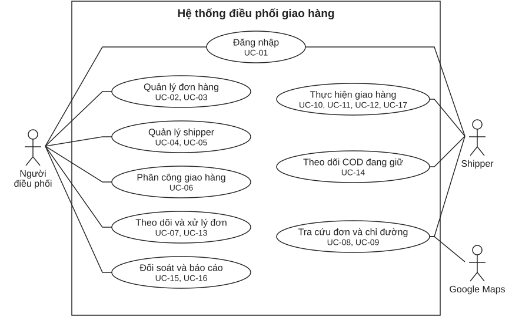

# Tài liệu Use Case

Thư mục này chứa bộ Use Case hoàn chỉnh của **Hệ thống điều phối giao hàng chặng cuối nội thành**.

## Tài liệu chính

- [Bản PDF](Tai-lieu-dac-ta-use-case.pdf): dùng để đọc, duyệt và nộp bài.
- [Bản Word](Tai-lieu-dac-ta-use-case.docx): dùng khi cần chỉnh sửa nội dung.

## Sơ đồ

- [Use Case tổng quan](diagrams/use-case-tong-quan.svg)
- [Use Case chi tiết Người điều phối](diagrams/use-case-dieu-phoi.svg)
- [Use Case chi tiết Shipper](diagrams/use-case-shipper.svg)
- [Sơ đồ trạng thái đơn hàng](diagrams/trang-thai-don-hang.svg)



## Phạm vi

Bộ tài liệu bao phủ UC-01 đến UC-17 với ba Actor:

- Người điều phối.
- Shipper.
- Google Maps.

Hai sơ đồ chi tiết thể hiện Association, `<<include>>` và `<<extend>>` theo ký pháp UML. Màu sắc sử dụng palette của diagrams.net/draw.io.

## Chỉnh sửa sơ đồ

Mã nguồn PlantUML nằm trong thư mục [`plantuml`](plantuml/):

- `use-case-tong-quan.puml`
- `use-case-dieu-phoi.puml`
- `use-case-shipper.puml`
- `trang-thai-don-hang.puml`

Sau khi chỉnh sửa, render lại tệp SVG tương ứng và lưu trong thư mục [`diagrams`](diagrams/). Không commit file render thử, file tạm hoặc bản nháp.

## Cấu trúc thư mục

```text
use-case/
├── README.md
├── Tai-lieu-dac-ta-use-case.docx
├── Tai-lieu-dac-ta-use-case.pdf
├── diagrams/
│   ├── use-case-tong-quan.svg
│   ├── use-case-dieu-phoi.svg
│   ├── use-case-shipper.svg
│   └── trang-thai-don-hang.svg
└── plantuml/
    ├── use-case-tong-quan.puml
    ├── use-case-dieu-phoi.puml
    ├── use-case-shipper.puml
    └── trang-thai-don-hang.puml
```
